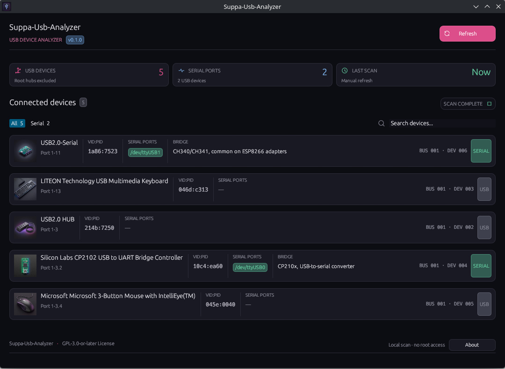

# Suppa-Usb-Analyzer

[Visit the Suppaworld project page](https://suppaman80.github.io/Suppa-Usb-Analyzer/)

Suppa-Usb-Analyzer is a native Linux desktop application that scans connected
USB devices and serial ports, presenting their details in one clear,
searchable view.

## What it does

- Detects connected USB devices and associated `ttyUSB` and `ttyACM` serial ports.
- Displays device names, VID:PID identifiers, USB paths, and available serial ports.
- Recognizes common USB-to-serial bridges such as CH340/CH341, CP210x, FTDI, and PL2303.
- Shows device-specific icons for peripherals, hubs, serial adapters, and development boards.
- Supports device search, serial-only filtering, and manual refresh.
- Scans locally without requiring root access or sending device data to a cloud service.

## Download

Download the latest Linux x86_64 AppImage from
[GitHub Releases](https://github.com/Suppaman80/Suppa-Usb-Analyzer/releases/latest).

## License

Released under the GNU General Public License, version 3 or later
(GPL-3.0-or-later). See [LICENSE](LICENSE).
